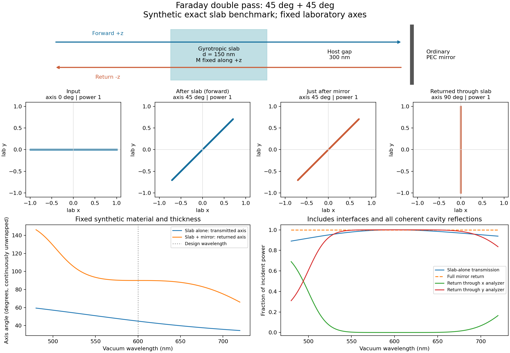

# 材料—镜面—材料：单程 45°，往返 90°

v0.3.0，2026-10-26。这个例子已经运行并通过独立 Maxwell 边界条件测试。

固定实验室坐标，从左向右沿 $+z$ 入射，磁化保持沿 $+z$：

$$
0^\circ\xrightarrow{\text{正向穿过材料}}45^\circ
\xrightarrow{\text{普通镜面反射}}45^\circ
\xrightarrow{\text{反向穿过同一材料}}90^\circ.
$$

**第二个 45° 发生在返程穿过磁光材料时。** 正入射的各向同性普通镜面给两个偏振分量乘上
同一个复数，不会单独把线偏振再转 45°。这里磁化没有随光的传播方向反转。
这一双程非互易机制也见 [Ansys 的 Faraday 旋转与隔离器示例](https://optics.ansys.com/hc/en-us/articles/360042274774-Faraday-effect-and-optical-isolator)。

## 这次实际构造的材料

使用相对介电张量（时间约定 $e^{-i\omega t}$、相对磁导率 $\mu=1$）：

$$
\boldsymbol\epsilon=
\begin{pmatrix}2.5&1.5i&0\\-1.5i&2.5&0\\0&0&2.5\end{pmatrix}.
$$

它是被动、无损的**合成材料参数**，不是某种真实材料的测量值。
真空波长 $\lambda_0=600\,\mathrm{nm}$，材料厚度 $d=150\,\mathrm{nm}$，环境折射率 $n_h=1$。
镜面与材料后表面相距 300 nm，镜面采用理想 PEC，局部电场反射系数 $r_m=-1$。

两个固定实验室圆偏振
$\mathbf e_\pm=(\hat{\mathbf x}\pm i\hat{\mathbf y})/\sqrt2$ 的折射率为

$$
n_+=\sqrt{\epsilon_d-g}=1,\qquad n_-=\sqrt{\epsilon_d+g}=2.
$$

一支与环境匹配，所以界面不反射；另一支在膜内积累的相位为 $\pi$，
恰好处于半波 Fabry–Perot 全透射共振。**界面反射已经计算，不是被忽略。**
两支的整个膜透射系数分别为 $t_+=i$、$t_-=-1$，净反射都为零。

令通常的实二维旋转矩阵为

$$
R(\theta)=\begin{pmatrix}\cos\theta&-\sin\theta\\\sin\theta&\cos\theta\end{pmatrix}.
$$

把圆通道转换回 $x,y$ 后，整个膜的 Jones 矩阵为

$$
T=e^{3\pi i/4}R(45^\circ).
$$

共同相位不改变偏振轴。固定磁化下，返程在相同实验室坐标里作用的矩阵仍是 $T$，
不是 $T^{-1}$。镜面及间隙的共同因子为 $m=r_m e^{2ik_h\ell}$，所以在这个零反射设计点

$$
J_{\rm return}=mT^2=m e^{3\pi i/2}R(90^\circ).
$$

对本例 $\ell=300\,\mathrm{nm}$，入射 $\mathbf E_{\rm in}=(1,0)^T$ 最后得到
$\mathbf E_{\rm return}=(0,i)^T$，即正交的 $y$ 线偏振。
这不是仅仅把观察方向翻转造成的角度变化：固定 $x$ 检偏器测到零返回功率，$y$ 检偏器测到全部返回功率。

| 采样位置 | 偏振轴 | 相对入射功率 |
|---|---:|---:|
| 入射 | 0° | 1 |
| 正向穿过材料后 | 45° | 1 |
| 刚经普通镜面反射 | 45° | 1 |
| 返程穿过材料后 | 90° | 1 |

原始结果：[45° 例子的 result.json](reports/2026-10-26-faraday-mirror/angle45/result.json)。



上排光路上下错开仅为了展示传播方向，实际计算是正入射原路折返。
中排画的是对应端口实际 Jones 场的偏振轨迹，不是预先画好的角度。
底排扫描固定的合成材料和厚度；谱图中的角度为连续展开后的轴角。
设计点以外的反射和多次往返会改变响应，不能一概使用“任意波长总角度都是单程角度的两倍”。
图没有把材料内部的驻波场简化成一条线性增长的偏振角曲线。

## 代码如何包含反射和损耗

每个圆通道取出射支 $n_s=\sqrt{\epsilon_d\mp gm}$，定义

$$
\rho_s=\frac{n_h-n_s}{n_h+n_s},\qquad p_s=e^{ik_0n_sd},
$$

$$
r_s=\frac{\rho_s(1-p_s^2)}{1-\rho_s^2p_s^2},\qquad
t_s=\frac{(1-\rho_s^2)p_s}{1-\rho_s^2p_s^2}.
$$

这已经包含薄膜内部全部相干反射。镜面接入后，外部完整反射为

$$
r_{{\rm total},s}=r_s+\frac{t_s^2m}{1-r_sm}.
$$

第一项是薄膜直接反射；后项包括镜面一次及全部后续腔内往返。
程序同时返回直接反射、第一次镜面返回、全部腔内返回，避免把它们混淆。
只有 $r_s=0$ 的设计点，这个结果才退化成 $mt_s^2$。

允许被动复介电参数和 $|r_m|\le1$ 的不透明镜面终端；$1-|r_m|^2$ 被解释为镜面吸收，
不是独立的镜后透射端口。生产代码的材料吸收算符由能流差得到，
独立测试则直接积分膜内焦耳热：

$$
\mathcal A_s=\frac{k_0}{n_h}\operatorname{Im}\epsilon_s
\int_0^d |E_s(z)|^2\,dz,
$$

再加上镜面吸收检查入射功率守恒。

## 把 XX 改成其他角度

可以指定 $|\theta|<90^\circ$。令 $u=|\theta|/90^\circ$，构造

$$
n_{\rm low}=n_h,\qquad n_{\rm high}=\frac{n_h}{1-u},\qquad
d=\frac{\lambda_0}{2n_{\rm high}},
$$

$$
\epsilon_d=\frac{n_{\rm low}^2+n_{\rm high}^2}{2},\qquad
g=\operatorname{sgn}(\theta)\frac{n_{\rm high}^2-n_{\rm low}^2}{2}.
$$

这会重新构造一组满足目标角度的**合成介电参数和厚度**，并不是调节一块真实材料的磁场模型。
接近 90° 时所需高折射率发散，因此该构造不接受 $|\theta|\ge90^\circ$。
程序也实际运行了 30° 的例子，结果为 0°→30°→30°→60°，见
[30° 原始结果](reports/2026-10-26-faraday-mirror/angle30/result.json)。

在 `magneto_optics` 目录执行，输出目录须不存在：

```powershell
..\mof_scattering_handoff_20261013\.venv\Scripts\python.exe scripts/demo_faraday_mirror.py --angle-deg 45 --out runs/mirror45
..\mof_scattering_handoff_20261013\.venv\Scripts\python.exe scripts/demo_faraday_mirror.py --angle-deg 30 --out runs/mirror30
```

也可以在安装了本模块及 `[report]` 依赖的环境里使用 `python`。
其他参数：`--wavelength-nm`、`--host-index`、`--gap-nm`。
输出包括设计参数、复 Jones 矩阵、各阶段复电场/偏振/功率、121 波长光谱、PNG/SVG 图和源码哈希。
偏振轴本身模 180°，因此 −90° 与 +90° 是同一条轴，比较符号时需看完整 Jones 场或连续展开。

## 验收与模型范围

本轮全套 **364 项测试通过**，其中新增 **67 项**双程测试。
见 [测试日志](reports/2026-10-26-faraday-mirror/pytest.txt) 和
[独立边界条件测试源码](tests/test_faraday_mirror.py)。独立参考直接解两界面的 E/H 连续条件和镜面边界，
不调用生产代码的 Fresnel 递推公式；损耗参考使用膜内场体积分。
覆盖不同角度、磁化反转、普通无磁光材料、复损耗、不同间隙和非理想镜面，
也检查互易旋光器的理想往返抵消对照。
45° 示例整个 121 点扫描的无损返回能量最大误差为 $1.11\times10^{-15}$。

这是**均匀磁光薄膜的一维精确 Maxwell 基准**，与小球电偶极近似不同。
它没有声称完成任意周期纳米颗粒超表面紧贴镜面的模拟；后者还涉及镜面的反射 Green 函数、
倏逝场以及多衍射级往返耦合。这个清晰的双程例子可以作为后续扩展的独立验收目标。
