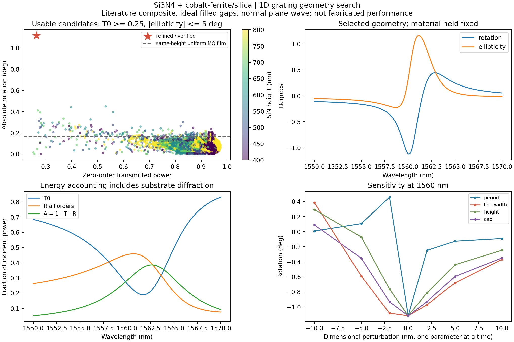
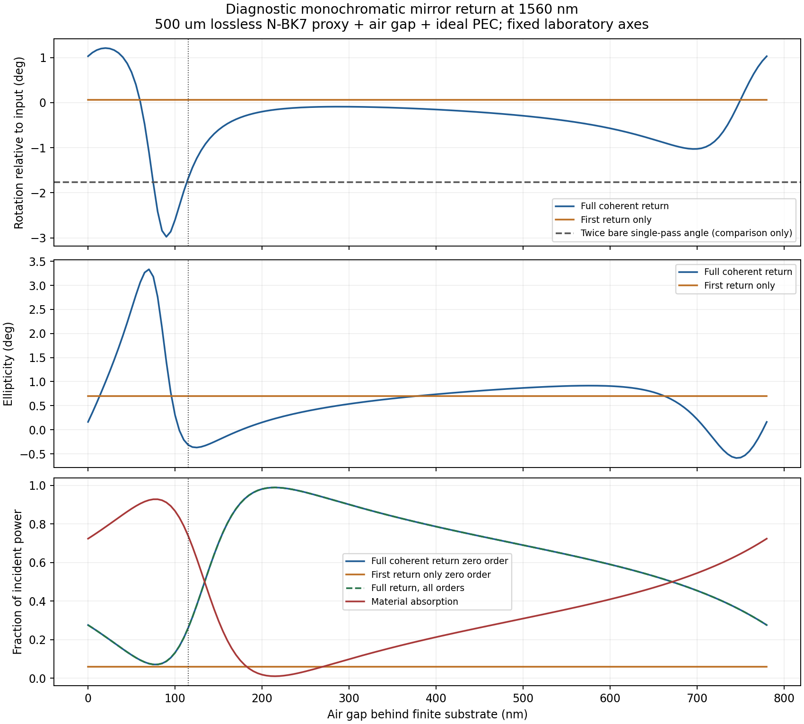

# Fixed-material magneto-optical grating scan

Version 0.5.0, 2026-10-31. The first full-wave search finds **1.116 degrees of
single-pass rotation at 1560 nm, with 26.33% transmitted power and 0.326 degrees
of ellipticity**. This is **6.74 times** the rotation of a uniform composite film
with the same total height, or **21.25 times** a film containing the same composite
volume per unit area. The power-weighted figure of merit improves by **3.70 times**
against the same-height film. These denominators are different and should not be
interchanged.

This is a simulation candidate for a **one-dimensional grating**, invariant along
the strips. It is not a two-dimensional post lattice, a fabricated result, a
polarization-independent rotator, or a real-material 45-degree device. We kept
the published material parameters fixed throughout the search.



## What is being scanned?

Light enters from air along +z. The strips run along y and repeat along x.
The selected input is TE: its electric field points along the strips. The model
from front to back is:

1. A uniform magnetic-composite cap.
2. Si3N4 strips with completely composite-filled rectangular gaps.
3. A 30 nm overetched substrate region, with the same filled gaps.
4. A glass substrate, modeled as a half space for the single-pass search.

We use the CoFe2O4/silica composite reported by
[Royer et al.](https://doi.org/10.1021/acsomega.9b03728), with
$n+i\kappa=1.69+0.006i$, the documented conversion
$\epsilon_d=2.856064+0.02028i$ and $g=-0.00375-0.0018i$.
The source-based Si3N4 index is 1.95. See [REAL_MATERIALS.md](REAL_MATERIALS.md)
for the tensor-sign assumptions, magnetic state, absorption and provenance.
The composite input is a **local constant approximation over 1550–1570 nm**;
it is not a measured dispersion curve, and the code rejects extrapolation.

The glass index uses [SCHOTT's N-BK7 Sellmeier data](https://media.schott.com/api/public/content/41e799d0bf874807a0bb8e702fbb75b5?v=54856406):

$$
n^2(\lambda)=1+\sum_{j=1}^3\frac{B_j\lambda^2}{\lambda^2-C_j},
$$

with wavelength in micrometres,
$B=(1.039612120,0.231792344,1.010469450)$ and
$C=(0.006000699,0.0200179144,103.56065300)$.
At 1560 nm, $n=1.50052657$. N-BK7 is a documented proxy for the paper's BK7,
not the measured substrate batch. Glass absorption is neglected. This is especially
relevant to the illustrative thick-substrate mirror model below.

The user accepted a provisional 1550–1570 nm band, minimum gap 200 nm, and
pattern height 400–800 nm. We searched periods 850–1100 nm, fill fraction
0.4–0.8, and hypothetical cap thickness 0–100 nm. Complete infiltration,
vertical walls and a uniform cap are explicit assumptions: the actual coating
profile has not been measured. The source paper's principal TE peak lies beyond
1570 nm, so this bounded search retunes geometry into our material band; it does
not claim to reproduce the full experimental spectrum.

## The result and the cost of enhancement

The refined mathematical geometry is:

| Quantity | Value |
|---|---:|
| Period | 925.042 nm |
| Si3N4 strip width | 691.538 nm |
| Composite-filled gap | 233.504 nm |
| Si3N4 height | 573.739 nm |
| Uniform composite cap | 82.051 nm |
| Substrate overetch | 30 nm |
| Input polarization | TE, along the strips |

Extra decimal places identify the simulated point; they are not a fabrication
tolerance. Rounding period, line width, height and cap independently to a 1 nm
grid gives 925/692/574/82 nm, **1.091 degrees** and **27.17% transmission**.
Rounding to a 5 nm grid gives 23.33% transmission and fails our provisional 25%
screen. No mask or process release is implied.

At 1560 nm and the adopted positive saturated magnetization:

| Structure | Rotation | Zero-order transmitted power | Ellipticity |
|---|---:|---:|---:|
| Uniform composite, same total height | -0.16558 deg | 87.46% | -0.09321 deg |
| Uniform composite, same MO volume/area | -0.05252 deg | 89.34% | -0.03908 deg |
| Refined grating | **-1.11607 deg** | **26.33%** | **+0.32604 deg** |

The reference film thicknesses are $h+30+c$ and $(1-f)(h+30)+c$, respectively,
where $h$ is strip height, $c$ cap thickness and $f$ Si3N4 fill fraction. Both
references use the same air/glass ports and the same lossy composite.

At the grating point, reflection is 45.32% and absorption is 28.34%. Its crossed
analyzer output is only 0.01084% of incident power: a one-degree rotation is still
a small rotation even when its enhancement factor sounds large. Reversing M
reverses rotation and ellipticity; zero M gives zero TE-to-TM conversion.
The sign is tied to our fixed laboratory axes and adopted source tensor mapping.

We maximize

$$
F=|\theta|\sqrt{T_0},\qquad T_0\geq0.25,\quad |\chi|\leq5^\circ.
$$

These are provisional study screens, not requirements supplied for a finished
device. Here $T_0$ is usable zero-order power; light diffracted into other orders
does not count toward it. We still include **every open order** in total energy
accounting. Substrate diffraction starts near period 1040 nm at 1560 nm, inside
the search interval. A large angle with almost no output cannot win this screen.

The search evaluates 4,230 coarse geometries at 1560 nm and both input axes,
then performs Powell refinement and six joint constrained resonance searches.
The latter change period, fill, height and cap together so a narrow resonance is
not lost by changing just one dimension. Finalists are re-ranked at higher
Fourier order. This is an exploratory search; no global optimum is proven.
The selected geometry is then evaluated at 401 wavelengths across 1550–1570 nm.

## Why the lattice can help, and why it is sensitive

A grating can hold light in a guided resonance. The light interacts with the
magnetic coating longer, so its two polarization components change more before
escaping. Absorption also acts for longer. A stronger resonance is therefore not
automatically a better transmitted beam.

For a broadband source, we add the **Stokes intensities** at different wavelengths,
not complex fields or rotation angles. For Gaussian spectra centered at 1560 nm:

| Spectral FWHM | Averaged rotation | Averaged transmission |
|---|---:|---:|
| Monochromatic | -1.1161 deg | 26.33% |
| 0.5 nm | -1.0790 deg | 26.37% |
| 2 nm | -0.7895 deg | 26.94% |
| 7 nm | -0.2475 deg | 34.94% |

The Gaussian is truncated and normalized inside the material band. We use
trapezoidal integration and compare 0.1 and 0.05 nm grids. Degrees of polarization
are also recorded; averaging spectra can produce partially polarized light.
This is spectral averaging only, not a simulation of angular divergence.

A -2 nm period perturbation gives +0.457 degrees; +2 nm gives -0.249 degrees.
For this perturbation the fill fraction stays fixed, so strip and gap widths
scale with period. Separate tests change line width at fixed period, height, and
cap by ±2, ±5 and ±10 nm. These are one-at-a-time sensitivities, not a statistical
manufacturing-yield estimate. The resonance is not yet a robust fabrication
design. Actual coating profile and available process precision must determine
the next optimization objective.

## Maxwell equations used by the new solver

The X-ray Debye sum is not used for this electromagnetic calculation. We solve
Maxwell's equations with time convention $e^{-i\omega t}$, $\mu=1$, and

$$
\boldsymbol\epsilon(x)=
\begin{pmatrix}e(x)&ig(x)M&0\\-ig(x)M&e(x)&0\\0&0&e(x)\end{pmatrix}.
$$

The spatial harmonics are $e^{i2\pi m x/\Lambda}$ for $m=-N,\ldots,N$.
They describe the waves scattered sideways by the repeating strips. Increasing
$N$ adds finer spatial detail; it must change the answer only slightly before
we accept a candidate.

At a vertical interface, $D_x$ and $E_y$ are continuous but $E_x$ can jump.
Consequently, blindly multiplying truncated Fourier series is inaccurate.
We apply [Li's inverse factorization](https://doi.org/10.1364/JOSAA.13.001870).
Let $C(a)$ mean the convolution matrix of the exact Fourier coefficients of $a$,
and absorb M into g. Define

$$
A=C(1/e),\quad B=C(ig/e),\quad D=C(e-g^2/e),\quad
K=\operatorname{diag}(m\lambda/\Lambda).
$$

The effective transverse constitutive blocks are

$$
E_{xx}=A^{-1},\quad E_{xy}=A^{-1}B,\quad
E_{yx}=-BA^{-1},\quad E_{yy}=D-BA^{-1}B.
$$

For harmonic vectors $\mathbf u=(E_x,E_y)$ and
$\mathbf v=Z_0(H_y,-H_x)$,

$$
\partial_z\mathbf u=ik_0P\mathbf v,\qquad
\partial_z\mathbf v=ik_0Q\mathbf u,
$$

$$
P=\begin{pmatrix}I-KC(e)^{-1}K&0\\0&I\end{pmatrix},\qquad
Q=\begin{pmatrix}E_{xx}&E_{xy}\\E_{yx}&E_{yy}-K^2\end{pmatrix}.
$$

We solve the eigenproblem for $PQ$, match tangential E/H at layer interfaces,
and cascade scattering matrices with decaying propagation. This avoids the
exponentially growing transfer matrices of thick or evanescent layers.
The implementation is [grating.py](src/magnetooptics/grating.py).

For an outgoing propagating harmonic with
$q_m=\sqrt{n^2-(m\lambda/\Lambda)^2}$, its power relative to a unit normal
incident electric field is

$$
P_m=\frac{(n^2/q_m)|E_{x,m}|^2+q_m|E_{y,m}|^2}{n_\mathrm{incident}}.
$$

The different x/y weights include the longitudinal electric field of oblique
TM diffraction. Evanescent harmonics stay in the boundary calculation but do
not carry independent outgoing far-field power. The solver rejects an exterior
Rayleigh cutoff or a truncation that omits an open propagating order.
Production absorption is $1-\sum_mT_m-\sum_mR_m$; independent tests additionally
integrate the original material's Joule heating, rather than treating this
subtraction as proof of energy conservation.

## Mirror return is computed, not set to twice the angle

For a diagnostic calculation we add a **500 micrometre lossless glass substrate**,
an air gap and an **ideal PEC mirror**. These are explicitly illustrative inputs,
not measured substrate thickness or purchased-mirror data. The gap scan reuses
one full scattering matrix at 157 gaps from 0 to 780 nm.

With full harmonic scattering blocks and round-trip gap load $L$,

$$
L_{mm}=r_m e^{2ik_0q_m d},\qquad
J_\mathrm{return}=R_l+T_{rl}L(I-R_rL)^{-1}T_{lr}.
$$

The right-side reflection and actual reverse transmission must be used.
All retained evanescent orders participate; replacing these blocks with just
their 2x2 zero-order submatrices can be wrong near a mirror. A PEC has tangential
electric reflection -1 for every harmonic. Arbitrary complex scalar mirror
coefficients are rejected when evanescent orders exist because $|r|\leq1$ alone
does not ensure their passivity. Real mirror coatings need an appropriate
order/polarization-dependent model.

At the best screened sampled gap, **115 nm**, the complete coherent return has
**-1.6832 degrees rotation, 26.01% returned power, and -0.3141 degrees ellipticity**.
Material absorption is 73.99%; the ideal PEC absorbs nothing. The separately
reported first round-trip field has +0.0669 degrees rotation, 5.97% power and
0.6981 degrees ellipticity. These are different observables: the full return
includes prompt reflection and later cavity trips.

The grating is anisotropic, so even its first return need not have twice the
bare transmission angle. This is not yet the polarization-independent
XX-degrees-plus-XX-degrees rotator requested earlier. Thick-substrate spectral
fringes are not averaged in this monochromatic diagnostic. Actual substrate
thickness, coherence, mirror data and coating profile are needed for a prototype
prediction. See [mirror results](reports/2026-10-31-grating-scan/mirror/summary.json).



## Validation, speed and reproduction

**555 tests passed**, including 105 new grating/design/mirror cases. Independent
tests cover analytic Fresnel and circular-mode film solutions, asymmetric stacks,
full Maxwell boundary solves, pointwise volume heating, M reversal, zero-g
conversion, all-order lossless flux, layer splitting, thick-layer stability,
Fourier refinement, Stokes averaging and mirror feedback. For the selected
cap/grating/overetch geometry at order 3, an independently assembled boundary
solution and original-tensor Joule integral agree with the production flux-loss
operator within $2.7\times10^{-13}$. This low-order test checks discrete physics;
it does not establish spatial convergence by itself.

The candidate is checked at orders 3,5,7,9,13,17,21,25,31. Between orders 25 and
31, rotation changes by $1.36\times10^{-5}$ degrees and transmission by
$6.04\times10^{-6}$ of incident power. Additional order-31/41 checks at the band
ends, center and spectral extrema show at most $1.12\times10^{-4}$ degrees of
rotation change. These are empirical refinement checks, not rigorous error
bounds or uncertainty in the material measurements. Mirror order-21/31 changes
are below 0.00015 degrees and 0.000006 in the reported powers.

The recorded run used 6,863 Maxwell solves: about **79 seconds inside the solver**
and **82 seconds before plotting** on this workstation with one BLAS thread.
Small dense matrices benefit from avoiding thread overhead. The coarse search
uses low harmonic order; only promising candidates and acceptance spectra use
larger matrices. The mirror's 157 feedback evaluations took **0.15 seconds** by
reusing the grating scattering matrix; its five Maxwell validation solves took
0.46 seconds. These are measured study timings, not hardware-independent claims.

From `magneto_optics`, with the existing environment:

```powershell
..\mof_scattering_handoff_20261013\.venv\Scripts\python.exe -m pip install -e ".[test,report]"
..\mof_scattering_handoff_20261013\.venv\Scripts\python.exe scripts/scan_grating.py --out runs/my-grating-scan
..\mof_scattering_handoff_20261013\.venv\Scripts\python.exe scripts/scan_grating_mirror.py --candidate runs/my-grating-scan/candidate.json --out runs/my-mirror-scan
..\mof_scattering_handoff_20261013\.venv\Scripts\python.exe -m pytest -q
```

Use `--quick` on the first scan for a smaller smoke study; it is not the saved
full search. Output directories must be new. The checked report includes
[input and source hashes, full metrics and assumptions](reports/2026-10-31-grating-scan/summary.json),
coarse/refined CSVs, spectral and tolerance CSVs, the candidate JSON, convergence
records, plots and test logs. The next design work should optimize robustness to
actual process variations and beam bandwidth, and assess a symmetric two-dimensional
cell or additional resonator degrees of freedom for larger useful rotation.
