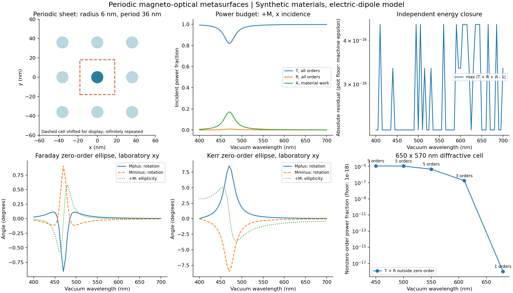

# 周期磁光超表面：结构、物理和性能验收

日期：**2026-10-26**。模块版本：**0.2.0**。

本轮目标已按用户澄清调整为周期超表面的透射、反射及 Faraday/Kerr 响应，先用合成材料验证。
已交付二维 Ewald 周期 Green 核、全部传播衍射端口、Jones 矩阵、偏振椭圆、独立材料吸收、
严格输入检查、4 个可运行示例及性能优化。数学和运行方法见 [周期教程](PERIODIC_TUTORIAL.md)。

**适用范围：**矩形二维无限周期、正入射、共面分离小球、上下相同的无损宿主，每个球一个电偶极子。
不包含基底、斜入射、多层结构、真实材料拟合和颗粒内部高阶多极。
下文的数值误差是在这个模型内部测量，不能当成任意真实器件的 Maxwell 物理误差。

## 1. 结构和软件验收

完整磁光模块 **297 项测试通过**，1.84 s，其中原有有限阵列测试 195 项，本轮新增周期测试 102 项。
证据：[pytest 文本](reports/2026-10-26/pytest.txt)、[JUnit XML](reports/2026-10-26/pytest.xml)。

新增测试覆盖：

- 单元内球数、周期尺寸、最小中心/表面距离、不同半径，以及跨边界、跨角点、自身副本的碰撞。
- 原始坐标不自动吸附或包裹；非共面、重复位置、非法材料、未采样的主动材料表节点等会报错。
- Ewald 解析短程 Hessian 的独立微分核对、截断收敛、分拆参数变化、Bloch 核互易性。
- 全部传播衍射级、场的横向性、相位与法向能流权重、零级透射包含入射波。
- 零反射时 Kerr 角未定义，圆偏振时长轴角未定义；角度差正确处理周期分支。
- 多材料、不等半径、位置平移与粒子编号置换；缓存与逐项参考的完整光谱比较。
- 无磁性各向异性单元可以有原始偏振旋转，但磁化奇对称信号为零。
- 内存限额、Rayleigh 掠射阈值、未收敛求和和非法 JSON 的失败行为，以及保存配置的实际字节哈希。

有限阵列求解器只改了一个元数据说明，使其正确描述周期自身副本耦合；求解代数未改变。
原有 X 射线模块独立保留，文件完整性复核记录在本轮交付核验数据中。

## 2. 独立物理验收

[acceptance.json](reports/2026-10-26/physics/acceptance.json) 中的 **14 项判据全部通过**。
主要结果如下，数值是实际测量值，不是容差设置。

| 独立检查 | 观测误差 |
|---|---:|
| 静电方形晶格和，对 $4\zeta(3/2)\beta(3/2)$ 解析参考 | 相对误差 $4.13\times10^{-9}$ |
| 动态 Ewald，对独立 Gaussian–Abel 阻尼实空间外推 | 相对误差 $1.63\times10^{-10}$ |
| 独立实空间参考自身加密 | 相对变化 $1.84\times10^{-9}$ |
| 周期自项虚部，对所有开放衍射通道辐射恒等式 | 相对误差 $5.55\times10^{-16}$ |
| 单球正方单元圆偏振闭式透射/反射 | 相对误差 $3.58\times10^{-16}$ |
| Faraday/Kerr 椭圆角，对圆通道闭式解 | 最大绝对差 $1.42\times10^{-14}$ 度 |
| 磁化反转 Jones–Onsager 关系 | 相对误差 $5.31\times10^{-17}$ |
| 局部场耗散，对介电损耗矩阵独立吸收公式 | 绝对功率差 $1.73\times10^{-18}$ |
| 原胞与含 6 球的重复超胞，零级反射场 | 相对误差 $4.67\times10^{-16}$ |
| 超胞折叠产生的虚假开放级次 | 功率 $3.15\times10^{-36}$ |

静态检查使用 $ka=10^{-4}$，不是把非零频率结果当成精确静态值；动态实空间对照使用 $ka=1.3$。
Abel 外推是收敛的独立数值参考，仍不是严格误差区间。

多衍射级测试包含每侧 **9 个传播级次**，使用有损和无损张量。
有损例子中非零级次携带入射功率的 $3.7446\times10^{-4}$；只看零级会漏掉这部分能量。
独立计算的 $T+R+\mathcal A-1$ 在这些测试中为浮点舍入级别。

另外，两个球的合成单元对 **61 个波长、每波长 4 个线性系统**进行了完整逐项参考对照。
最大无量纲输出绝对差 $8.67\times10^{-19}$，Jones 元素最大绝对差 $4.34\times10^{-19}$，
输出角度在保存精度下相同。使用绝对误差，避免对零磁光信号除零。
见 [全谱比较](reports/2026-10-26/spectrum_comparison.json) 和
[参考输出](reports/2026-10-26/examples/two_site_reference/metadata.json)。

## 3. 可运行的合成光谱

全部例子使用一条线程，每个波长求 $+M/-M$ 和 $x/y$ 四个线性系统，圆偏振由线性组合得到。
单元重复无限多次；这里的“1 球”“2 球”都指**每单元球数**。

| 配置 | 波长点数 | 计算时间 | 整条 CLI 时间 |
|---|---:|---:|---:|
| 正方 36×36 nm 单元，半径 6 nm 单球 | 61 | 0.270 s | 1.198 s |
| 72×60 nm 单元，2 个不同半径的球 | 61 | 0.322 s | 1.385 s |
| 650×570 nm 双球单元，包含非零级衍射 | 5 | 0.0667 s | 1.104 s |
| 无损磁光单球单元 | 4 | 0.0543 s | 1.101 s |

每项是一次顺序实际运行。计算时间包含核构造、求解、端口与结果组装；CLI 时间另含启动、导入、
输入验证和写文件。不能把小例子的导入耗时当成数值内核速度。
全部示例最大能量闭合残差 $4.44\times10^{-16}$。
原始时间见 [timings.json](reports/2026-10-26/examples/timings.json)。

正方单球示例在采样的 470 nm 处，$+M$ 的透射旋转约 $-0.908^\circ$、反射旋转约
$8.49^\circ$；相应 $T=0.8183$、$R=0.009345$、$\mathcal A=0.1723$。
反射不到 1%，所以不能仅以较大的 Kerr 角评价信号强弱。这只是明确标注的合成模型示例。



图中的所有曲线来自保存的 CSV；几何图只显示无限阵列中的九个副本，虚线为平移后的等价单元。
非零级功率直接对各级次求和，没有用接近 1 的数字相减提取微弱信号。

## 4. 实测性能与加速拆分

机器：Intel Core i5-12400，6 核/12 线程；Windows，Python 3.11.9，NumPy 2.4.6，SciPy 1.17.1。
基准固定 **1 个 BLAS 线程**、complex128。一次测量包含一个波长下四个线性系统、两次 LU 分解、
四次残差检查和端口输出。核构造时间包含 Ewald 截断加密检查。
导入、JSON I/O、几何准备和预热不计入下表。

基准单元的颗粒半径 6 nm，网格间距 36×41 nm，波长 620 nm；逐点介电常数有位置依赖，
所以大单元具有真正不同的基元响应，不只是把完全相同的单球重复命名。
完整配方、逐次测量和环境见 [benchmark.json](reports/2026-10-26/performance/benchmark.json)。

### 相同精度下逐级优化

下面取 **3 次测量中位数**，每轮轮换执行顺序。

| 每单元球数 | 逐项参考总时间 | 无缓存向量化 | 向量化＋缓存 | 缓存相对无缓存向量化 |
|---:|---:|---:|---:|---:|
| 16 | 1.485 s | 0.0599 s | 0.00858 s | **6.98×** |
| 36 | 7.774 s | 0.3026 s | 0.0191 s | **15.84×** |

这里“逐项参考”使用 Python 逐对、逐晶格项累加，便于核对，不代表优化过的原有实现。
36 球例子中，单看核构造，向量化＋缓存相对无缓存向量化快 **20.32×**；
总流程快 **15.84×**。相对朴素逐项参考的总加速约 407×，其中包含向量化和缓存两种收益。

三路径比较中最大 Green 矩阵相对差 $2.94\times10^{-16}$，偶极解相对差
$1.33\times10^{-16}$，T/R/A 最大绝对差 $1.11\times10^{-16}$。
三种后端共享 Ewald 公式，所以公式本身的正确性仍由第 2 节的独立参考承担。

### 更大复杂单元

以下各为 **一次实测**，没有外推慢参考耗时。每例另以更严格容差及改变 25% 的 Ewald 分拆参数复核。

| 每单元球数 | 单元周期 nm | 核构造 | 四通道求解 | 全流程 |
|---:|---|---:|---:|---:|
| 64 | 288×328 | 0.0307 s | 0.00315 s | 0.0392 s |
| 144 | 432×492 | 0.0701 s | 0.0177 s | 0.0977 s |
| 256 | 576×656 | 0.1438 s | 0.0699 s | **0.2305 s** |

加密/分拆复核最大 Green 相对变化 $1.06\times10^{-15}$，偶极解相对变化 $3.24\times10^{-16}$，
T/R/A 最大绝对变化 $2.08\times10^{-17}$。大单元复核属于同算法收敛验证，不是同规模独立慢算法对照。
全部性能例子的能量闭合残差不超过 $4.44\times10^{-16}$。
256 球构造的数组/工作区估计约 50.6 MiB；这是保守分配估计，**没有测量进程峰值 RSS**。

### 已定位的瓶颈与下一步

256 球单元的核构造约占总时间 **62%**，求解约占 **30%**。
本轮已实施晶格项向量化、严格相等位移的缓存、正入射位移反演对称性，以及跨磁化/偏振的矩阵复用。
没有坐标取整、几何近似或裁掉远处周期副本来换取速度。

规则位置使许多位移重复；任意无序基元可能几乎没有缓存收益。
目前仍是 $O(N^2)$ 稠密存储与 $O(N^3)$ LU，不能把这里的结果外推到任意万球复杂单元。
若后续确需更大单元，优先测量周期 FFT/矩阵自由乘法及迭代预条件的收益，再对照本版稠密解验收。
GPU、斜入射与基底没有计入本次性能成果。

## 5. 复现与证据

从 `magneto_optics` 目录运行，输出目录必须不存在：

```powershell
python -m pytest -q -o junit_family=xunit1
python scripts/validate_periodic.py --out runs/new_periodic_physics
python scripts/benchmark_periodic.py --out runs/new_periodic_performance
python scripts/run_periodic_examples.py --out runs/new_periodic_examples
python scripts/plot_periodic_report.py --report runs/new_periodic_examples
```

全谱慢参考可把 `two_site_sheet.json` 的 `solver.backend` 设为 `reference` 后运行，再执行
`scripts/compare_periodic_spectra.py --actual <缓存结果目录> --reference <参考结果目录> --out <新的JSON路径>`。
未安装时，把 `python` 替换为教程给出的现有环境路径。

每次结果记录当前源码和输入的 SHA-256；[MANIFEST.sha256](MANIFEST.sha256) 列出当前磁光模块交付文件。
历史 `reports/2026-10-25` 保持原样，其源码哈希属于有限阵列 v0.1.0。
本轮交付核验见 [delivery_checks.json](reports/2026-10-26/delivery_checks.json)。
