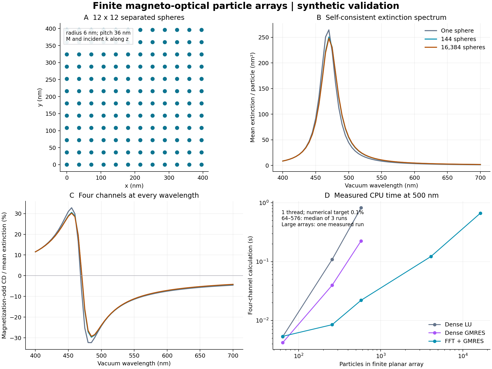

# 磁光结构、物理响应与性能验收

日期：2026-10-25。版本：magnetooptics 0.1.0。
范围：有限、互不相交的小球电偶极阵列，均匀无损宿主，合成被动磁光介电张量。

本轮完成独立模块、严格输入、物理基准、加速求解、完整光谱示例和可重跑的原始证据。
原有 X 射线源码及历史数据未改动，原有 **980 项测试通过**。
新模块最终 **195 项测试通过**，无失败、跳过或警告；测试日志见
[pytest.txt](reports/2026-10-25/pytest.txt) 和 [pytest.xml](reports/2026-10-25/pytest.xml)。



图中的材料均为合成测试材料。右下角只连接二维阵列的实测时间；不同几何没有混画成同一条规模曲线。

## 结构与输入验收

已验证：颗粒数、单位和坐标、完整外包络、最小中心间距、不同球半径下的最小表面间距、
重叠/相切拒绝、稀疏缺陷和非立方网格、整体平移不变性、有限边界不发生周期回绕。
离网格坐标只接受支持它的稠密算法，不做自动坐标取整。

材料检查使用 Hermitian 损耗矩阵的本征值。每个输入色散表节点均须被动，不允许外推。
零材料对比度必须严格给出零散射。零散射或完全圆偏振时，未定义的偏振量用空值表示。

JSON 拒绝未知字段、重复键和 NaN/Infinity。输出目录不会覆盖；配置先校验再创建结果。
保存的配置与源码按**实际文件字节**计算 SHA-256，避免 Windows 换行转换导致摘要失配。

## 独立物理验收

[acceptance.json](reports/2026-10-25/physics/acceptance.json) 中的 **13 项定量标准全部通过**。
这些参考没有把同一个生产求解器再调用一遍充当解析解。

| 检查 | 实测误差/结果 |
|---|---:|
| 单球圆偏振本征极化率，相对误差 | 1.88×10⁻¹⁶ |
| 单球截面独立公式，相对误差 | 2.31×10⁻¹³ |
| 双颗粒纵/横向、同/反相模式闭式解，相对误差 | 2.20×10⁻¹⁶ |
| 对称阵列磁化反转交换圆偏振通道 | 1.62×10⁻¹⁶ |
| 零磁光耦合的圆偏振退简并 | 0 |
| 独立远场角积分与能量关系，相对误差 | 4.36×10⁻¹⁴ |
| 角积分加密后的相对变化 | 1.72×10⁻¹⁵ |
| 无损体系吸收 / 消光的绝对值 | 2.80×10⁻¹⁴ |

测试还包含三个不同材料、非共线磁化颗粒的 Onsager 源交换关系
$T(-M)=T(+M)^T$，并区分普通转置与共轭转置。这能发现张量乘法次序错误。
双颗粒反相驱动属于规定的外场测试，不标成均匀平面波照明。

### 偶极模型自身的误差

用独立完整 Mie 级数对照标量介电常数 $\epsilon=2.25+0.1i$、真空波长 600 nm、
宿主折射率 1 的球；Mie 级数从 6 阶到 8 阶的结果收敛。

| 尺寸参数 | 消光模型误差 | 散射模型误差 | 解释 |
|---|---:|---:|---|
| $ka=0.02$ | 0.02244% | 0.002847% | 这个指定的小球例子低于 0.1% |
| $ka=0.08$ | 0.3571% | 0.04513% | 消光超出 0.1%，展示单电偶极近似的边界 |

因此，以下很小的 FFT/迭代误差并不证明实际材料、所有尺寸或共振附近都具有 0.1% 的 Maxwell 精度。
尺寸筛查通过也不等于物理验收通过。当前没有把该近似误差藏在数值收敛阈值里。

## 同结构加速对照

环境：Windows、Python 3.11.9、NumPy 2.4.6、SciPy 1.17.1；本机 6 个物理 CPU 核心，
所有表中测试固定 **1 个 BLAS/FFT 工作线程**，complex128。
材料为 $\epsilon_d=-2.5+0.5i$、$g=0.06+0.01i$；半径 6 nm，间距 36 nm，
宿主折射率 1，波长 500 nm。每组包括正/负磁化和两个圆偏振共 **4 次求解**。

时间包括 Green 核准备、系统构造、求解和截面计算；不包括进程启动、输入生成、导入或文件写入。
小结构取三次实测中位数。原始数据含每次分项时间、残差、迭代次数和内存：
[benchmark.json](reports/2026-10-25/performance/benchmark.json)。

| 有限阵列 | 颗粒数 | 稠密 LU | 稠密 GMRES | FFT＋GMRES | FFT 相对 LU |
|---|---:|---:|---:|---:|---:|
| 8×8×1 | 64 | 0.00530 s | 0.00420 s | 0.00538 s | 0.99× |
| 16×16×1 | 256 | 0.10894 s | 0.03974 s | 0.00848 s | 12.85× |
| 24×24×1 | 576 | 0.82466 s | 0.22518 s | 0.02205 s | 37.41× |

很小的结构使用 FFT 不一定更快，所以保留稠密参考入口。
在这些同结构对照中，FFT 相对 LU 的最大偶极向量范数误差为 **8.17×10⁻¹⁰**，
截面相对误差最大 **4.38×10⁻¹¹**；磁化奇对称 CD 的绝对误差以平均消光归一化后
最大 **1.83×10⁻¹²**。均低于本轮 0.1% 数值目标。

## 实测大阵列

下面仍为 500 nm 的四通道计算，每个大结构实际执行一次。这里没有运行巨大稠密矩阵，
也没有把估计的稠密时间称为实测加速比。

| 阵列 | 颗粒数 | 含球半径的外包络 | FFT 总耗时 | 采样峰值进程 RSS |
|---|---:|---|---:|---:|
| 64×64×1 | 4,096 | 2.280×2.280 μm，厚 12 nm | 0.123 s | 77.7 MiB |
| 128×128×1 | 16,384 | 4.584×4.584 μm，厚 12 nm | 0.668 s | 105.5 MiB |
| 24×24×24 | 13,824 | 840×840×840 nm | 1.888 s | 121.2 MiB |

RSS 每 2 ms 采样，可能漏掉短暂峰值；它包含 Python/库开销，与算法数组估算分开保存。
大结构使用 $10^{-9}$ 残差目标，并另算 $10^{-11}$ 的加密参考。
最大截面变化 **3.51×10⁻¹¹**，最大归一化 CD 变化 **2.96×10⁻¹¹**。
这属于迭代容差加密检查，不冒充同尺寸独立稠密验证。

## 完整光谱，而不只是单个波长

实际运行了 `examples/synthetic/large_array.json`：**16,384 颗粒，400–700 nm 的 61 个波长点，
每点 4 个磁化/偏振通道，共 244 个耦合系统解**。

- 经过输入校验后的计算耗时：**43.669 s**。
- 含 Python 启动、导入、输入校验和文件输出：**44.706 s**。
- 全谱最大真实相对残差：**9.93×10⁻¹¹**。
- 结构最小表面间隙 24 nm；数据保存在 [large_array/](reports/2026-10-25/large_array/)。

同样的 61 点示范光谱在 144 颗粒上又与稠密 LU 全通道对照。所有已报告的误差指标最大
**7.54×10⁻¹²**，见 [spectrum_comparison.json](reports/2026-10-25/spectrum_comparison.json)。
截面在有足够信号处比较相对误差；可能接近零的 CD 使用消光尺度下的绝对误差。
这些对照在相同波长坐标完成，不是对波长采样间隙内峰值误差的保证。

单球、144 颗粒阵列、512 颗粒三维结构及大阵列的完整运行记录见
[example_timings.json](reports/2026-10-25/example_timings.json)。

## 瓶颈与后续加速方向

稠密 LU 在 576 颗粒案例中，四通道求解/分解约占 0.654 s，Green 矩阵准备约 0.157 s。
改用稠密 GMRES 后矩阵准备占主要部分；FFT 消除了保存和构造全部颗粒对矩阵的需要。

在 16,384 颗粒的 FFT 案例中，求解耗时 0.638 s，占总时间约 **96%**；3D 案例约 **97%**。
下一阶段值得针对迭代内部的 FFT、向量正交化和共振处迭代数进一步做 profiling。
可考虑相邻波长初值复用、多个右端的块迭代、更强预条件器和 GPU；这些尚未实现，
不计入本轮已获得的速度。

当前没有为了加速而截断远场相互作用、降低为单精度或周期回绕。
FFT 网格以外的结构和大包围盒稀疏结构需要另选算法；高阶光学模式需要改进物理表示。

## 重跑与证据完整性

从 `magneto_optics` 目录运行（已有仓库环境）：

```powershell
..\mof_scattering_handoff_20261013\.venv\Scripts\python.exe -m pytest -q -o junit_family=xunit1
..\mof_scattering_handoff_20261013\.venv\Scripts\python.exe scripts/validate_magneto.py --out runs/new_physics
..\mof_scattering_handoff_20261013\.venv\Scripts\python.exe scripts/benchmark_magneto.py --out runs/new_performance --threads 1
..\mof_scattering_handoff_20261013\.venv\Scripts\python.exe scripts/run_magneto.py --config examples/synthetic/large_array.json --out runs/new_large_array
```

源码和配置哈希写入各次结果，模块文件清单另见 `MANIFEST.sha256`。原有 handoff 的
1,029 个文件保留其开发清单；此次新增磁光代码没有重写历史验收或供应商来源记录。
