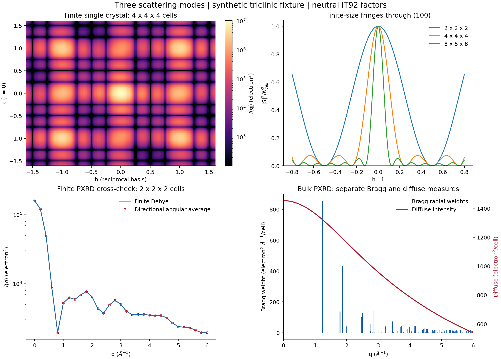

# Three scattering modes: v0.2 delivery

Completed 13 October 2026 on branch `codex/three-scattering-modes`.
The minimum roadmap core R00-R06 and R11 is implemented and validated. Additional
R08 memory/caching improvements are included. Run instructions and the complete
input/output contract are in [MODE_GUIDE.md](mof_debye_lab/MODE_GUIDE.md).

## Implemented behavior

| Case | Implemented output |
|---|---|
| Finite single crystal | Tiled complex amplitudes, directional intensity, all explicit interference components, analytic or sampled independent-pore ensemble moments, exact complete-cell shape factorization |
| Periodic single crystal | Triclinic reciprocal enumeration, Bragg weights including `(2*pi)^3/V`, separate continuous diffuse scattering, separate forward weight, unbiased sampled mean-square correction |
| PXRD, finite | Existing full Debye calculation and four-part analytical ensemble, explicit realizations, angular directional moment projection, complete-cell lattice grouping |
| PXRD, bulk | Correct radial reflection-shell weights/multiplicity and angular-averaged diffuse scattering under the documented per-cell measure |

The versioned CLI separates physics case, boundary, estimator and backend.
Five runnable configurations use the same synthetic triclinic C/O/Zn cell and
illustrative Au templates; the fifth demonstrates constrained sampled moments.
All five ran successfully through the installed `mofdebye` entry point. Unsupported
combinations fail explicitly, including directional Debye requests, correlated
configuration fields, repeated-random-cell bulk models, periodic host-clearance,
and mixing installed native factors into IT92 analytical guest terms.

Whole-particle occupancy and host-guest/guest-guest interference are retained.
Within-cell joint-state enumeration is available through the Python moment API;
the configuration interface models independent pores. Periodic hard-wall spheres
are checked against translated neighbors, including skew cells. Finite guest
retention is by retained pore site, keeping the whole rigid particle; no implicit
external surface clipping or reconstruction occurs.

## Baseline and tests actually executed

- Both original manifests passed before source edits (85 outer entries and 61
  inner entries). The original ZIP remains unchanged.
- Baseline: **30 passed in 10.13 s**; analytical CLI and 64-sample forced-grid
  bounded CLI passed. Logs and results: [baseline](local_runs/baseline/).
- Final complete suite: **142 passed in 19.78 s**, including all original tests
  and the installed public-API checks. The six warnings are upstream deprecated
  `importlib.resources.open_text` calls. [Log](local_runs/pytest_v02.txt),
  [JUnit](local_runs/pytest_v02.xml).
- Both compatibility examples reran successfully. Their intensity CSV arrays
  are numerically identical to the reproduced baseline (maximum difference 0).
- All five new examples completed; CSV and metadata are saved in
  [local_runs/examples](local_runs/examples/).

New coverage includes one-/two-atom and q=0 checks, mixed species, empty limits,
translation phase/rotation covariance, all interference components, converged
angular Debye equivalence, irregular/triclinic cell masks, finite fringes and
width scaling, occupancy p rather than p squared, exact joint-state enumeration,
conditional sampling, numerical mean-square bias, periodic Bernoulli variance,
extinctions/multiplicity, and actual finite-to-bulk integrated production paths.
Tests also cover no full atomic expansion for host-only lattice paths, tiled
distance/sinc memory behavior, streaming Monte Carlo and reusable pair caches.

## Numerical and performance evidence

Executed on Intel Core i5-12400, Python 3.11.9 64-bit, Windows, Torch 2.11.0+cpu,
NumPy 2.4.6, SciPy 1.17.1 and Gemmi 0.7.5. CUDA was unavailable and is untested.
Benchmark runs use one CPU thread, float64, one warmup and three measured repeats.
The local venv inherited installed dependencies; project installation modified
only the venv. An initial no-build-isolation install lacked `bdist_wheel`; normal
isolated build installation then succeeded. Both logs are preserved.

| Validation | Measured result on the synthetic fixtures |
|---|---:|
| Refined angular powder vs direct Debye, relative L2 | 1.78e-15 |
| Explicit vs factorized directional amplitude, scaled error | <=9.49e-16 |
| Lattice powder vs direct, bandwise scaled error | <=2.55e-15 |
| Forced adapted grid vs direct, including high q | <=4.80e-11 |
| Independent-cell full enumeration agreement | 3.59e-16 |
| Incorrectly repeating one random cell, relative L2 discrepancy | 20.15% in this fixture |
| Production shape integration, relative geometric mass error | <=6.7e-16 |

For the 256-atom benchmark, median evaluation times were **0.14152 s reference**,
**0.008950 s forced adapted grid**, and **0.006465 s cached lattice**. Lattice
preprocessing took 0.000482 s and stored 30,184 bytes of pair distances. These are
small CPU benchmarks, not a general scaling or GPU claim. Raw repetitions,
q-band errors, weak-feature residuals, input fixture, memory records and arrays
are in [validation.json](local_runs/validation_v02/validation.json) and its
adjacent CSV/NPZ files. The process-lifetime high-water working set was
384,790,528 bytes; it is **not** an isolated per-method peak. Separate
tracemalloc probes have their allocation scope explicitly labeled.



The figure and [PDF](local_runs/validation_v02/three_modes.pdf) show reciprocal
intensity, finite fringes, the powder cross-check and bulk Bragg/diffuse outputs.
Numerical agreement establishes consistency of the selected forward model;
it does not establish real-material prediction accuracy.

## Installed package verification

The actual installed DebyeCalculator is **1.0.14**, so the unverified 1.1.1 pin
was replaced. Its public API is batched direct and has no grid selector.
Independent Waasmaier-Kirfel coefficient checks showed its native intensity is
half the conventional full Debye intensity; the adapter applies an explicit x2
correction. Twelve tests passed. CPU medians were 0.0844 s for 192 atoms and
1.0151 s for 648 atoms; native-factor bandwise numerical errors were <=3.69e-15.
Differences from Gemmi IT92 were recorded separately (about 8.52e-4 in the
high-q band of these examples). See [installed evidence](local_runs/installed/cpu_validation.json).
The adapted vendor kernel remains separately attributed and licensed.

## Roadmap status and limits

| Roadmap | Status |
|---|---|
| R00 baseline | Complete, reproduced before refactoring |
| R01 installed adapter | Complete on CPU; CUDA unavailable |
| R02 case/configuration contract | Complete with compatibility and rejection tests |
| R03 finite directional | Complete with cross-mode tests and factorization |
| R04 moments | Complete for independent pores and enumerated within-cell states |
| R05 periodic Bragg/diffuse | Complete for independent cells and fixed host |
| R06 finite/bulk PXRD | Complete with separate radial convention and three-case examples |
| R07 CIF/pore/surface layer | Deferred; explicit XYZ/basis, fractional/Cartesian pores and full-cell masks supported |
| R08 acceleration/cache | Partially complete: integrated full-cell cache, reference tiling, streaming ensemble; broader basis/shape scaling and specialized atom-cut residual acceleration remain |
| R09 broader pore models | Deferred beyond existing constrained sampler; no inter-cell correlations or general interparticle exclusion |
| R10 instrument/profile layer | Deferred; raw intensities/weights only |
| R11 delivery | Complete: source, tests, examples, logs, raw evidence and support documentation |

Host-only complete-cell fast paths avoid expanding all atoms. Analytical
host-guest cross terms for masked populations still expand the finite host.
The adapted grid histograms and installed package are not globally memory
bounded; dense FFT bounding grids can be expensive for sparse shapes. Large-q
angular averages require convergence checks. Sampled coherent estimates can
be negative near extinctions and remain unclipped; mean-amplitude numerical
uncertainty is reported separately from physical diffuse variance, without
claiming an intensity SEM.

No real CIF, validated MOF pores, experimental distributions or instrument
settings were supplied. Automatic CIF expansion/pore finding, atomic surface
chemistry, host relaxation, correlated cells and detector/instrument physics
remain explicit future work.

## Provenance and integrity

Original `mof_debye_lab/results/`, `mof_debye_lab/logs/`, and `qa/` are preserved.
Intentional changes add directional/moment/periodic/runner/installed modules,
tests, examples and documentation, and update reference memory handling, caches,
compatibility metadata and verified package requirements. Original manifests
remain historical records and naturally differ for edited sources.
`SOURCE_AUDIT.json` lists changed original files and verifies preserved evidence.
The separate current manifest is checked with:

```powershell
.\.venv\Scripts\python.exe tools/verify_manifest.py --manifest DEVELOPMENT_MANIFEST.sha256
```
