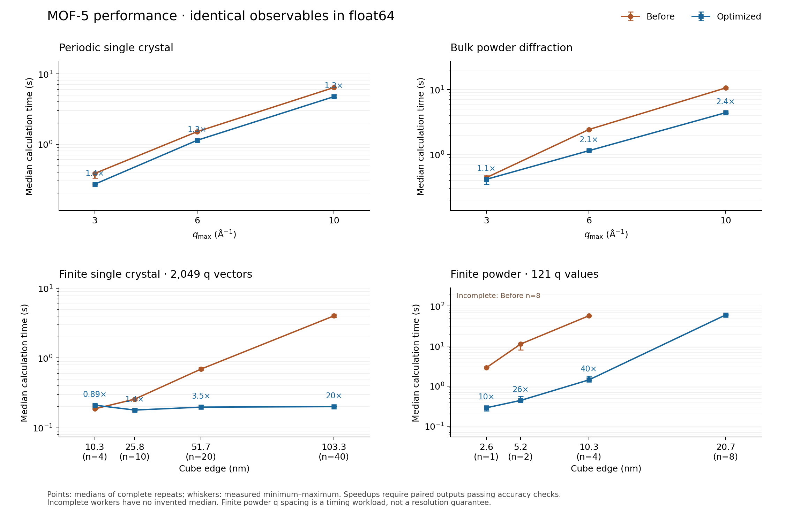

# MOF-size CPU performance and exact optimizations

Version 0.3.2, 2026-10-13. All three scattering modes were benchmarked against
the preserved v0.3.1 code with the same MOF-5/IRMOF-1 CIF, dependencies, q samples,
form factors and estimator settings. The study includes finite and bulk PXRD.
The changes preserve the physical model; no distance bins, interpolation,
angular coarsening or finite-to-bulk substitution was used to obtain a speedup.

## Main measured results

Times below are medians of three warm-interpreter calls, including fresh CIF
loading, geometry preparation, calculation and metadata. They exclude process
startup, file output and the separately collected profiles. CPU: Intel Core
i5-12400, 6 cores / 12 logical processors, about 32 GiB installed memory,
Windows, Python 3.11. NumPy/BLAS and PyTorch thread counts were fixed to one.
This is a CPU study; no CUDA device is available. Ranges and raw samples are in
the comparison CSV/JSON, so small timing changes should not be overinterpreted.

| Mode and workload | v0.3.1 | v0.3.2 | Speedup |
|---|---:|---:|---:|
| Finite single crystal, 103.3 nm cube, 27,136,000 conceptual atoms, 2,049 q vectors | 4.020 s | 0.201 s | 20.0x |
| Periodic single crystal, q <= 10 A^-1, 291,106 nonzero reciprocal vectors | 6.399 s | 4.742 s | 1.35x |
| Bulk PXRD, same reflection cutoff, 1,411 radial shells | 10.616 s | 4.419 s | 2.40x |
| Finite PXRD, 5.17 nm cube, 3,392 atoms, 121 q points | 11.265 s | 0.438 s | 25.7x |
| Finite PXRD, 10.33 nm cube, 27,136 atoms, 121 q points | 57.441 s | 1.430 s | 40.2x |
| Finite PXRD, 20.67 nm cube, 217,088 atoms, 121 q points | Incomplete within worker budget | 60.124 s | Not inferred |

The original 10.33 nm powder worker completed two calls before its aggregate
120-second timeout. A separate extended run then completed all three calls and
saved the raw outputs used above. The original 20.67 nm powder worker did not
complete a call within that budget. A worker budget includes startup, repeats
and an optional profile; it is not a per-call timing. No extrapolated baseline
or speedup is assigned to that last row.

Not every small workload became faster. The 10.33 nm finite single-crystal
case measured 0.187 s before and 0.211 s after; input/setup costs dominate there.
The 25.8 and 51.7 nm cases improved by 1.43x and 3.51x, respectively. The
synthetic four-site Au13 sampled-moment workloads improved by 1.60x at 512
samples per site and 1.16x at 2,048 samples, retaining identical random draws.
These guest microbenchmarks time `guest_moments` only after setup; they exclude
CIF loading, population construction and metadata generation.

[Complete timing and accuracy table](local_runs/performance_v032/comparison/performance_comparison.csv)
and [machine-readable comparison](local_runs/performance_v032/comparison/performance_comparison.json).

## Workload interpretation

The sourced structural model has 424 atoms per 25.832 A conventional cell,
including all original hydrogen atoms. Complete-cell cubes from 4 to 40 cells
per edge represent 10.3--103.3 nm single crystals. Finite powder uses 1, 2, 4
and 8 cells per edge. These are geometric complete-cell objects, with no surface
reconstruction or chemical passivation. The large atom counts are represented
through the repeated basis; they are not expanded into millions of coordinates.

Bulk calculations represent an infinite crystal, not a finite particle of a
specified size. Reciprocal cutoffs of 3, 6 and 10 A^-1 produce 7,880, 62,740
and 291,106 nonzero vectors, including extinct reflections. Powder weights and
finite intensities retain their distinct measures and normalization.

The 121-point powder grid over 0--6 A^-1 is a repeatable timing workload. It
does not resolve every narrow feature of the larger crystallites. Denser grids
were run separately below. The principal mode benchmarks use the empty real
framework; the separate Au13 sampling workload has explicitly synthetic sites.
It is not a validated guest-loaded MOF or an experimentally fitted population.

## Bottlenecks and implemented changes

**Finite single crystal.** The old shape factor sums every retained cell for
every q vector. A complete rectangular mask now uses the product of three
finite geometric sums, evaluated with principal angles and sinc limits near
Bragg points. General masks retain the explicit tiled path. The phase work
changes from O(number of cells x number of q vectors) to O(number of q vectors),
although validating the mask still costs O(number of cells). In the optimized
103 nm profile, CIF input processing takes about 80 percent of the call;
the actual cell/shape amplitude takes about 12 percent. Retaining the parsed
cell avoids repeated import costs for a fitting loop.

**Periodic single crystal and bulk PXRD.** The old q <= 10 profile spends
3.74 profiled seconds enumerating candidates individually in Python. Bounded
65,536-candidate vector batches reduce this stage to 0.087 profiled seconds.
Every candidate, cutoff rule and reflection remains present. Powder shell
aggregation now searches anchored groups and reduces arrays instead of calling
`isclose` for every reflection. The final periodic profile spends about 94
percent of its time in atomic amplitude evaluation, including phases, factors
and reductions; that is now its main
bottleneck. Under the restricted isotropic analytic guest model, bulk diffuse
variance is radial and also avoids redundant angular evaluation. Finite and
anisotropic sampled interference keep their directional calculation.

**Finite PXRD.** The baseline visits 118,848 species-pair basis displacements
separately. Exact inversion grouping, plus signed-permutation symmetry for an
exactly axis-aligned cubic cell and complete cubic mask, reduce this to 11,339
representatives for this CIF. Grouping identical float64 radii further reduces
the cached species-resolved radius libraries to 3,454 entries for one cell,
37,282 for 2^3 cells and 294,865 for 4^3 cells. Integer multiplicities preserve
all ordered pairs and self terms. The 10.33 nm profile now has only ten calls
to the weighted sinc evaluator, one per species pair. Sinc arithmetic remains
the largest evaluation cost as q grids grow.

**Sampled guests.** A call-local amplitude plan reuses IT92 form factors and
element masks across draws. The original rigid sampler, seed, rejection rules,
sample order, Welford accumulation and uncertainty calculation remain intact.
The optimized 2,048-sample profile spends roughly half its time in atomic
phases and most of the remainder generating rotations and placements. A
future batch sampler must preserve the same statistical law and conditioning;
reducing sample counts would change numerical integration uncertainty.

## Cache reuse, denser scans and memory

With the default 64 MiB radial payload budget, the 20.67 nm powder case falls
back to bounded streaming. The cached 10.33 nm case needs only 4.50 MiB for its
radius/count arrays. The larger case encounters an intermediate candidate
library above the default budget, even though its final globally combined
library is much smaller. The metadata records this fallback rather than
silently claiming cached execution.

An explicit 256 MiB cache construction budget was also tested through the
existing Python API. For the 20.67 nm cube it produces a final **35.54 MiB**
library after **7.10 s** of preparation. Its 121-point evaluation then takes
**8.17 s**, and a 601-point evaluation takes **29.95 s**. These are single
kernel calls with retained geometry, not three-repeat runner medians; they
exclude CIF loading and preparation. Common q points agree between the two
grids to 5.00e-15 in non-forward scaled error.

For the 10.33 nm cube, retained-cache medians are **1.14 s** for 121 points and
**11.68 s** for 1,201 points, after **0.383 s** preparation. Common q points
agree to 8.80e-16 in non-forward scaled error. These runs show the actual cost
of refining q sampling without replacing the exact powder calculation.

The standard runner's measured process RSS peaks are about 265 MiB for the
103 nm directional case, 329 MiB for the largest periodic calculation,
295 MiB for 10.33 nm powder and 539 MiB for streamed 20.67 nm powder. These
include the Python/scientific-library baseline, sampled every 5 ms. Repeated
calls can briefly retain previous outputs. The cache budget covers retained
radii and integer counts; shape FFTs, basis offsets and transient sorting
workspace are additional. The separate 256 MiB experiment did not measure
process RSS, so its payload size is not presented as a process-memory bound.

## Accuracy and regression evidence

All **735 tests pass**, including **62 new optimization regression cases**.
The six remaining warnings are existing dependency deprecations. All eight
physical examples pass their 32 comparisons again: their worst deterministic
scale-normalized error is 1.03e-15, and the sampled check remains within 0.792
exact standard errors.

All **15 completed before/after workload pairs** pass comparison of every
saved numerical column. Reflection indices and multiplicities match exactly;
the periodic single-crystal and sampled-guest arrays are bitwise identical.
Across all columns the worst scaled difference is **6.07e-13**. Excluding
forward scattering, the worst scaled difference is **3.57e-14**, and the worst
relative error for values above 1e-8 of the non-forward peak is **2.01e-12**.
Errors at extinction zeros are judged with absolute/scale-normalized measures,
not a singular relative-error ratio. Tiny differences are consistent with
reordered float64 summation. No intensity or variance was clipped to force a
passing comparison.

The 20.67 nm case was additionally evaluated with the original v0.3.1 code at
13 q points shared with the optimized 121-point grid. Non-forward scaled error
is 1.96e-14. The larger-budget retained cache agrees with the default streamed
result at all 121 points to 4.33e-15 in non-forward scaled error. These are
separate accuracy checks; the 13-point reference time is not compared against
the 121-point timings. Results are saved in
`local_runs/performance_v032/additional_accuracy.json`.

Tests independently cover explicit Debye sums, mixed species, incomplete
shapes, skew/left-handed cells, near-Bragg limits, a 100,000-cell chain,
reflection enumeration cutoffs, shell-tolerance boundaries, equal-radius
integer counts, cache budgets and stream fallback. Separate numerical records
and commands are under `local_runs/performance_v032/`.

## Practical next steps

For repeated fits, retain the imported cell and radial cache, and choose a
cache construction budget compatible with available memory. Reducing temporary
cache-building storage could make the 20 nm case cache successfully under a
smaller budget. For larger exact powder scans, compiled or parallel sinc
evaluation is the next measured bottleneck to address. For high-q periodic
work, atomic phase evaluation is the next target. These further speedups are
not claimed by this study.

The cubic powder shortcut does not apply to arbitrary atom cuts, noncubic
metrics or general sparse shapes; the exact fallback remains available.
Guest-loaded large finite objects and host-clearance rejection can have
additional costs not represented by the empty-framework size series. GPU,
multicore scaling, the full external DebyeCalculator package and instrument
models were not benchmarked here.

See [the reproduction guide](mof_debye_lab/PERFORMANCE_GUIDE.md) for commands,
source selection, profiling and reusable-cache examples. The original ZIP,
vendor files and protected baseline evidence remain unchanged. The verified
315-file v0.3.1 state was snapshotted before edits; intermediate displacement-
only results are retained separately from the final radial optimization.
