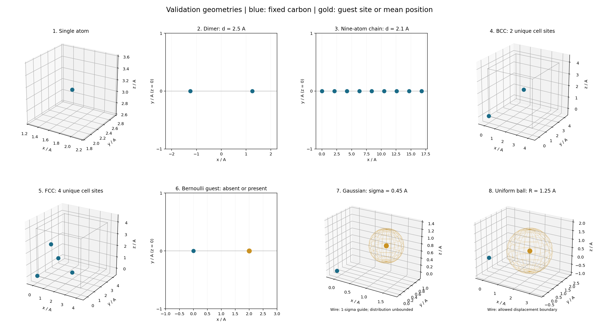
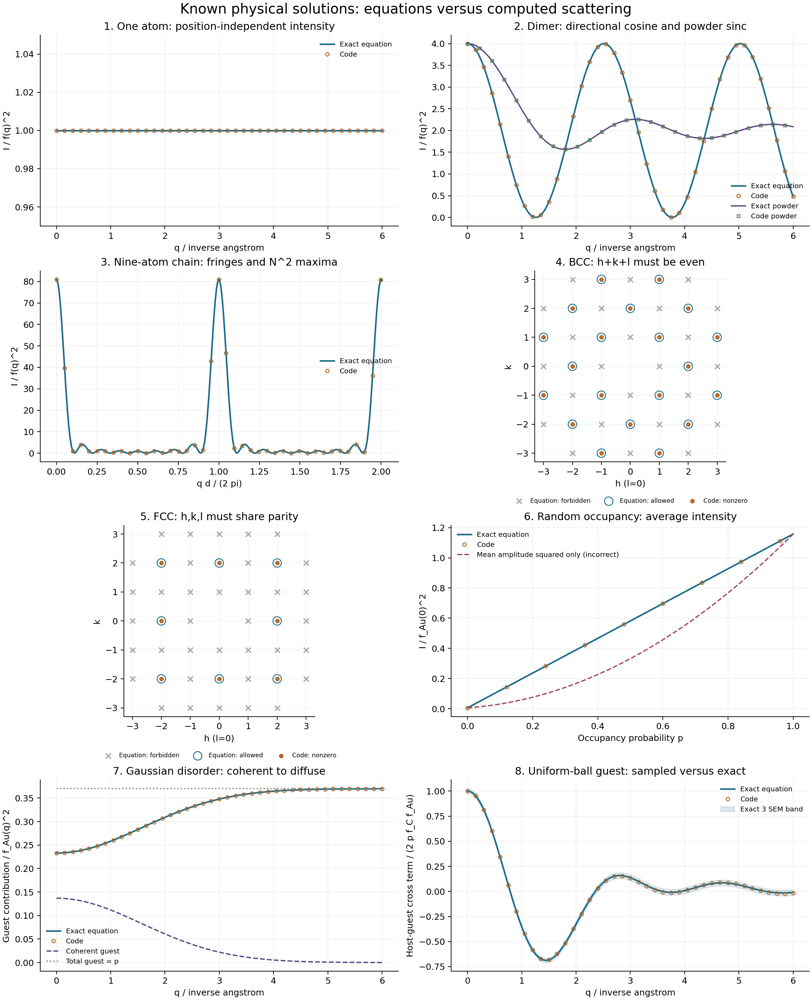

# Correctness checks against known physical solutions

Version 0.3.1, 2026-10-13. This campaign checks whether the calculations reproduce
known physical equations and independently enumerated configurations. It does
not make performance claims. The pre-test v0.3.0 suite passed all 279 tests, and
its 206-file development manifest was verified and saved with a complete snapshot
under `local_runs/r07_thorough/baseline/` before production changes.

The final full suite passed **673 tests**, including **394 new regression
cases**, with no skipped tests. Six existing dependency deprecation warnings
remain. The installed `mofdebye` CLI also ran the generated BCC configuration
successfully from outside the project directory. Exact commands, exit codes,
pytest output and JUnit results are saved in `local_runs/r07_thorough/`.

## Eight runnable examples

The driver generates its XYZ/CIF structures and JSON configurations, computes
the scattering, and checks 32 numerical comparisons. Thirty deterministic
comparisons use exact equations; two sampled comparisons use exact independent
integration uncertainties. The equations, their assumptions, and the errors
each example can detect are documented in
[the physical examples guide](mof_debye_lab/examples/physical/README.md).

| Example | Known answer tested |
|---|---|
| Single carbon atom | Intensity is `f(q)^2`, independent of its position |
| Carbon dimer, separation 2.5 A | Directional cosine fringes, transverse `4 f^2`, powder sinc, and exact destructive-interference zeros |
| Nine-atom chain, spacing 2.1 A | Finite grating law with `N^2 f^2` maxima; explicit and factorized amplitudes; powder pair counts |
| BCC CIF, cubic cell edge 4 A | Two expanded sites; `h+k+l` even selection rule; complete reciprocal-vector set and radial shell weights |
| FCC CIF, cubic cell edge 4 A | Four expanded sites; same-parity selection rule; complete reciprocal-vector set and radial shell weights |
| Bernoulli Au guest next to C | Exact absent/present average over occupancy probability; guest self scattering proportional to `p`, not `p^2` |
| Gaussian-displaced Au guest | Exact Gaussian characteristic function, host-guest interference, coherent/diffuse separation, finite intensity and bulk Bragg measure |
| Uniform-ball Au guest | Exact spherical characteristic function versus 8,192 actual draws; intensity and interference residuals checked using exact second moments |

For the BCC/FCC powder checks, the reference independently enumerates integer
triples in a reciprocal sphere and groups their squared integer lengths. It
does not reuse the production reflection list or shell grouping. Missing or
duplicate reflections, wrong multiplicities, and omitted shells therefore fail.

The maximum deterministic absolute error divided by
`max(1, max(abs(reference)))` is **1.03e-15** (rounded upward). This is a
scale-normalized error, not pointwise relative error at extinction zeros.
The uniform-ball total-intensity residual is at most **0.136 exact SEM**, and
its interference residual at most **0.792 exact SEM**. The acceptance limit is
6 SEM with a fixed recorded seed. This uncertainty is independently calculated
from the known random intensity, rather than treating the production complex
amplitude error as an intensity SEM.

From `mof_debye_lab/`:

```powershell
..\.venv\Scripts\python.exe scripts/validate_physical_examples.py --out ../local_runs/physical_examples
```

No downloads are required. `--no-plot` runs the same checks without rendering.
The data and results are in `local_runs/physical_examples/`: generated inputs,
raw per-run scattering tables and metadata, comparison CSVs, `summary.json`, and
PNG/PDF figures. Configurations under `inputs/` can also run individually using
`mofdebye --config ... --out ...`.





The geometries and probability laws are deliberately synthetic. The Gaussian
wire is a one-standard-deviation guide, not a hard boundary. Gold markers denote
guest sites or mean positions. BCC/FCC figures contain the unique sites of the
half-open conventional cell; upper-face periodic copies are not extra atoms.

## Independent stress checks

**Crystallography:** 344 new checks include all 230 standard space groups against
ASE's independent symmetry database. The largest coordinate discrepancy is
2.50e-15 A. Unit-scatterer complex structure factors at 31 integer wavevectors
per group differ by at most 2.77e-13. BCC, FCC and diamond amplitudes/extinctions
are also checked against explicit equations at 729 reflections each. Tests
cover alternate axes, rhombohedral settings, all 24 ambiguous origin choices,
special positions, invalid metrics and duplicate tolerances. ASE is optional;
those comparisons skip when it is absent, but it was installed and used here.

**Geometry and conditioned sampling:** 27 new checks include 180 nearest-host
queries against exhaustive lattice-image enumeration for skew, rotated and
left-handed cells, with independent translations by up to 100,000 lattice
cells. Maximum distance disagreement is 3.32e-10 A, with zero atom-index
mismatches. All 8,736 closed-cell-mask membership decisions agree with an
independent union-of-parallelepipeds test. Two 6,000-trial truncated-Gaussian
experiments preserve occupancy and number-weighted template probabilities;
conditional mean errors are at most 1.51 SEM and the largest distribution KS
statistic is 0.0224. Spherical cuts and fixed-seed reproducibility also pass.

**Combined scattering:** 13 new tests independently enumerate all 81 complete guest
configurations for two nonorthogonal cells, including vacancy and mixed sizes.
They compare full atomic phase sums and ordered Debye pairs against finite
cell moments, rotation/translation invariance, and all supported physical
case/boundary combinations. Angular refinement is checked against the exact
powder result; a deliberately coarse angular grid fails that accuracy target,
while refined grids converge. Independent truncated-Gaussian quadrature checks
centre and whole-particle surface conditioning. An additional real-MOF
algebraic test uses explicitly synthetic sites to check that mean Bragg
extinctions can coexist with nonzero disorder diffuse scattering; those sites
are not identified physical MOF pores. Complete-configuration intensity agrees
to a scale-normalized error of 8.71e-16. A refined 48-by-96 angular grid agrees
with the independent powder pair sum to 1.15e-15. The conditioned Gaussian
sample means agree with independent quadrature within 1.53 exact SEM; sampled
variances differ by at most 2.34 percent.

Detailed evidence and reproducers are under `local_runs/r07_thorough/` in
`cif/`, `geometry/` and `physics/`. Consolidated pytest logs and command records
are saved there separately from the preserved earlier runs.

## Finding and correction

No production scattering or geometry mismatch was found in these checks.
One input-validation defect was fixed: `max_attempts` previously accepted
booleans and truncated fractional values such as `1.9` to `1`. It now requires
a positive integer, with ten regression cases. The scientific kernels were
not changed. Version 0.3.1 identifies that validation correction.

Review also strengthened the tests themselves: an initially too-small
brute-force image box was enlarged and bounded rigorously; the powder reference
now enumerates its own reflection set; and the printed sampled error aggregates
both sampled observables. The initial failed reference run is retained with an
explanation in the CIF evidence, rather than attributed to a production defect.

The neutral IT92 factor table is a shared physical input. These tests check
geometry, interference, probability averaging and normalization; they do not
independently establish the empirical accuracy of the atomic table, chemistry,
instrument physics, or unimplemented correlated-disorder models. Original
archive, vendor notices and protected baseline evidence remain unchanged.
