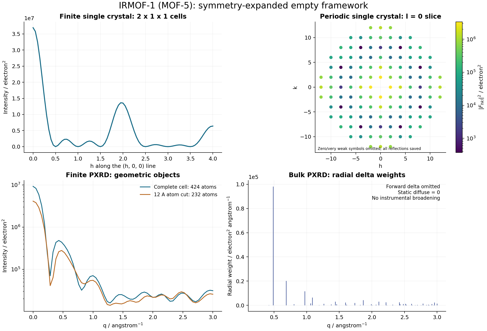

# R07 completion report: CIF, pores and finite boundaries

Delivered on 2026-10-13 as version 0.3.0. R07 connects crystallographic inputs
to all three existing scattering cases without changing their normalization.
The original v0.1 evidence and the v0.2 core delivery are preserved.

## Implemented behavior

- `mof_debye_lab/src/mofdebye/crystal.py` imports CIF through Gemmi, resolves and
  validates symmetry, expands fractional sites, and removes special-position
  and periodic duplicates using Cartesian distances in the full cell metric.
  It checks symmetry declarations, origin ambiguity, group closure, compatible
  cell geometry, declared site multiplicities and species conflicts. A selected block, source SHA-256,
  operations, atom labels, exclusions and preprocessing choices are recorded.
- Schema 1.1 accepts `host.cif` alongside the existing exclusive `host.xyz`
  path. Partial occupancy and unresolved disorder fail by default. Explicit
  exclusion or `drop_partial` policies are recorded; fractional occupancy is
  never silently converted to an unweighted full atom. Source H and solvent
  atoms remain unless explicitly excluded. Thermal and ionic-charge data do
  not change the existing neutral, static scattering model.
- Fractional/Cartesian pore coordinates use the imported cell. Optional pore
  symmetry expansion acts on nominal centres only; it does not rotate the
  placement probability law. Duplicate periodic pore sites fail validation.
  Finite masks replicate sites and per-site parameters consistently.
- `geometry.py` provides sphere/box atom cuts, complete-cell mask containment,
  and exact nearest periodic host distances. Atom cuts require an explicit
  `unpassivated_atom_cut` policy and use explicit retained coordinates rather
  than complete-cell factorization.
- Guest retention can use the legacy site rule, displaced centre containment,
  or whole-particle atom containment. Rejection preserves the chosen template
  size; impossible placement raises instead of biasing the size distribution.
  The restricted analytic formula rejects externally conditioned populations.
- Periodic host exclusion includes all potentially closer lattice images,
  including skew cells requiring more than adjacent images. It handles wrapped
  query positions without a fixed neighbor halo; excessive searches fail
  explicitly rather than truncating the distance.

The input contract and runnable commands are in
[R07_GUIDE.md](mof_debye_lab/R07_GUIDE.md). Schema 1.0 remains supported with its
previous behavior, including the previous periodic-host-clearance restriction.

## Validation

The pre-edit v0.2 baseline passed all 142 tests. Its 157-file development
manifest was verified, then copied with a complete matching snapshot into
`local_runs/r07_baseline/`. The final suite passed **279 tests in 15.41 seconds**,
including 137 new R07 checks. Logs are in `local_runs/r07_validation/pytest.txt`
and `pytest.xml`; exact validation commands are saved in `commands.json`.

New tests cover:

| Area | Independent checks and failure cases |
|---|---|
| CIF | P1, inversion, screw symmetry, nonorthogonal P21/c, special positions, declared multiplicities, periodic duplicates, mixed species, explicit/Hall/H-M/IT declarations, ambiguous origins, malformed coordinates/types/cells, occupancy, disorder and exclusions |
| Cell metric | Symmetry must preserve physical distances even when one unrelated axis is much longer; a mismatched tetragonal metric is rejected |
| Mode integration | Every CIF scattering path agrees with a separately written expanded nonorthogonal XYZ reference, including directional hkl and Cartesian coordinates |
| Surfaces and pores | Cell masks, box/sphere cuts, nominal-site filtering, centre versus whole-particle containment, fixed-size rejection, scalar/per-site parameter handling and sampled moments |
| Periodic clearance | Boundary-crossing and displaced guests, skew cells, images beyond adjacent cells and explicit search-limit failures |
| Real MOF | Independent coordinate expansion, source/license hashes, composition, F-centering extinctions, direct/factorized amplitudes, cut composition and all five configurations |

The full suite includes installed DebyeCalculator CPU checks. Its existing six
`importlib.resources.open_text` deprecation warnings do not indicate failures.
The installed `mofdebye` entry point also ran the real-MOF atom-cut configuration;
its raw result is under `local_runs/r07_validation/cli_atom_cut/`.

## Runnable real-MOF result

The bundled example is the RASPA2 reference simulation structure of IRMOF-1
(MOF-5), from a pinned upstream commit with an unmodified CIF and MIT notice.
It is not asserted to be a measured sample or an experimental CIF deposition.
See the [example README](mof_debye_lab/examples/real_mof/README.md) and
[provenance record](mof_debye_lab/examples/real_mof/provenance.json).

Seven asymmetric-unit records and 192 F m -3 m operations yield **424 atoms**:
C192 H96 O104 Zn32, or eight Zn4O(BDC)3 formula units. The cell edge is
25.832 angstrom. Independent Gemmi and ASE coordinate sets agree to eight
fractional decimal places. All source H atoms are retained.

From `mof_debye_lab/`, run:

```powershell
..\.venv\Scripts\python.exe scripts/run_real_mof_example.py --out ../local_runs/r07_real_mof
```

| Run | Result |
|---|---|
| Periodic single crystal | 7,880 reciprocal vectors through q = 3 inverse angstrom; ordered-host static diffuse intensity zero |
| Finite single crystal | Two complete cells, 848 atoms, factorized directional interference |
| Finite PXRD | One complete 424-atom cell, explicit full Debye calculation |
| Bulk PXRD | 128 nonzero radial shells, separate forward delta and zero static diffuse term |
| Spherical atom cut | Radius 12 angstrom inside one candidate cell; 232 atoms: C96 H48 O56 Zn32 |

All five runs completed. CSV tables, metadata, expanded unit-cell XYZ, the
summary and PNG/PDF figures are in `local_runs/r07_real_mof/`. The figure uses
separate axes and units for finite intensities and bulk delta weights.



The example is an empty framework because the source supplies no nanoparticle
pore coordinates or guest distribution. Synthetic integration tests establish
the CIF-to-pore connection without inventing material-specific loading data.
Chemical surface passivation, reconstruction, automatic pore finding, host
relaxation, correlated disorder and instrument/detector physics remain outside
R07. Very skew cells may require lattice reduction to stay within the explicit
periodic-image search limit. No GPU validation is claimed for this extension.

## Preservation and reproducibility

`COMPLETION_REPORT.md` remains the historical v0.2 report. Original `results/`,
`logs/`, `qa/` and vendor notices remain byte-identical; all 43 protected evidence
files were checked against the original manifest. `SOURCE_AUDIT.json` records
intentional changes relative to the original handoff and the saved v0.2 state.
The original ZIP is unchanged. Current delivery integrity is checked from the
handoff root with:

```powershell
.\.venv\Scripts\python.exe tools/verify_manifest.py --manifest DEVELOPMENT_MANIFEST.sha256
```

Dependencies remain isolated in the development venv, which inherits existing
read-only dependency installations. The editable package is now 0.3.0; its
Gemmi minimum is 0.7.5. A standard isolated editable build succeeded. This
machine's older setuptools lacked `bdist_wheel` when build isolation was
disabled, so installation uses the normal PEP 517 build path.
